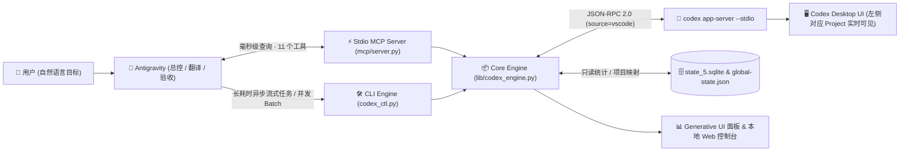

<div align="center">
  
  <h1>Antigravity Codex Bridge</h1>
  <p><strong>原生级 Google Antigravity ↔ OpenAI Codex 双引擎协同编排、UI 无感同步与可视化统计插件</strong></p>
  <p>
    <a href="./README_EN.md">English Documentation</a> ·
    <a href="#-核心优势解决什么痛点">核心优势</a> ·
    <a href="#-架构与工作原理">工作原理</a> ·
    <a href="#-三层可视化与统计交互体验">可视化面板</a> ·
    <a href="#-一分钟安装指南">快速安装</a>
  </p>
  <p>
    
    
    
    
  </p>
</div>

---

## ✨ 项目简介

**Antigravity Codex Bridge (`codex-bridge`)** 是一个零第三方依赖（纯 Python 3.11+ 标准库实现）的 **Google Antigravity 原生插件**，将 **Antigravity** 打造成你的 **“总工程师 + 需求翻译官 + 验收员”**，把本机已安装的 **OpenAI Codex（Desktop 桌面端 / CLI）** 变成随时待命的 **“二号执行与独立审查引擎”**。

无论是 **全栈软件开发、独立交叉 Code Review、系统脚本与电脑自动化、学术论文与数据处理、还是 CAE/CFD 科学工程仿真**，你只需在 Antigravity 中用大白话描述意图，插件即可全自动完成：**匹配项目 → 原生创建 Codex Desktop UI 可见会话 → 下发严谨指令 → 异步流式执行 → 留存一字不改的原始报告 → 用通俗中文向你解读结果**。

---

## 🚀 核心优势（解决什么痛点？）

| 传统双工具割裂痛点 | Codex Bridge 原生解决方案 |
| :--- | :--- |
| **输入门槛高**：复杂软件/工程任务给 Codex 写提示词时，不清楚该传哪些上下文、边界参数与安全约束 | **总控翻译闭环**：Antigravity 先阅读工作区并将自然语言转化为结构化 4 段式工程指令，再交由 Codex 执行 |
| **输出难消化**：Codex 跑完吐出大段底层命令、堆栈报错或专业数值指标，难以快速抓重点 | **原文留档 + 通俗解读**：自动生成完整 Markdown 原始报告备查，同时由 Antigravity 提炼通俗结论与下一步建议 |
| **命令行新建会话在 UI 消失**：直接跑 `codex exec` 会被打上 `source="exec"` 标签，被 Codex 桌面端侧边栏默认过滤隐藏 | **零手动原生 UI 同步**：直接对接官方 `codex app-server --stdio` 协议（`clientInfo="Codex Desktop"`），原生创建 `source="vscode"` 对话、自动命名并归入目标 Project；同时支持历史 `exec` 会话一键转正 |
| **Windows 桌面版找不到 CLI**：安装 Microsoft Store 版 Codex Desktop 后系统 `PATH` 无 `codex` 命令，且升级目录名随时变动 | **全平台动态寻址**：自动从配置、MSIX 包目录、macOS App Bundle 或 `.sandbox-bin` 定位最新 `codex` 可执行文件 |
| **MCP 同步调用长任务必超时**：复杂重构、测试或仿真动辄运行数分钟至数十分钟，纯 MCP 工具极易卡死断连 | **快慢分离双通道架构**：毫秒级查询/建会话/分支走 **11 个原生 MCP 工具**；长耗时执行走 **`codex-ctl` 异步流式引擎 + `codex-delegate` 独立子代理**，永不超时 |
| **配额与算力黑盒**：不清楚周配额还剩多少、70+ 个项目各自消耗了多少 Token | **实时配额监控 + 三形态可视化 UI**：实时读取账户剩余配额百分比、重置倒计时、模型占比与活跃趋势图 |

---

## 🧠 架构与工作原理



---

## 📊 三层可视化与统计交互体验

插件原生提供 **三种可视化交互形态**，按场景自由选用：

1. **Antigravity 对话内联卡片（Inline Generative UI Widget）**
   直接在聊天流内嵌入轻量交互卡片，一目了然展示：**纳管项目总数、UI 可见会话数、账户实时剩余配额 % 与重置倒计时、各模型 Token 占比条、最近 14 个活跃日算力柱状图**。
2. **Antigravity 侧边栏全屏控制台（4-Tab Standalone Artifact）**
   - **数据与配额**：全局 KPI、实时配额进度条、当前可用模型清单、Top 8 高算力项目、UI 同步健康体检。
   - **项目库搜索**：秒级检索全部 Codex 项目路径与活跃度，一键复制打开 UI 或定向派单指令。
   - **会话与分支管理**：过滤查看全部会话（区分 `UI 可见` 与 `隐藏 exec`），一键触发 **原始过程解读**、**派生新分支（Fork）** 或 **接续指挥**。
   - **泛用交互式派单器**：支持选择项目、指定模型、切换模式（只读诊断 / 读写开发 / 独立审查 / 多路并发会诊）及 6 大领域预设模板，自动组装高质量对话指令。
3. **独立本地实时 Web 控制台（`http://127.0.0.1:8765`）**
   运行 `codex-ctl serve-web` 即可在浏览器中打开实时管理后台：直接点击任意会话在线阅读完整原始问答与底层 Shell 命令输出、一键 Fork 分支、一键导出 Markdown 报告、一键转正 `exec` 会话，或在网页上直接发起新任务。

---

## 🧰 功能清单

### 1. 11 个原生 MCP 工具（`codex-bridge`）
| MCP 工具名 | 用途说明 |
| :--- | :--- |
| `codex_bridge_overview` | 全局项目、会话分类计数、模型 Token 分布、每日活跃趋势与指派统计 |
| `codex_bridge_quota_and_models` | 实时查询 Codex 账户配额已用/剩余百分比、重置时间及当前可用模型目录 |
| `codex_bridge_doctor` | 8 项环境自检（Python、Codex 二进制、登录态、SQLite 库、`app-server` 握手延迟等） |
| `codex_bridge_list_projects` | 检索全部 Codex Desktop 项目（含根路径、会话数、累计 Token 与最近活跃时间） |
| `codex_bridge_list_threads` | 按项目、关键词或可见性（`ui` / `exec` / `subagent`）检索会话 |
| `codex_bridge_read_thread` | 读取任意会话的原始用户指令、推理摘要、执行的底层命令及原始回复 |
| `codex_bridge_export_report` | 将任意历史会话一键导出为结构清晰的独立 Markdown 报告 |
| `codex_bridge_create_thread` | 零手动操作，在目标项目下原生创建带自定义标题的 Codex Desktop UI 会话 |
| `codex_bridge_fork_thread` | 基于已有会话无损派生（Fork）独立新分支，安全对比不同修改方案 |
| `codex_bridge_promote_exec_threads` | 将旧版命令行 `source="exec"` 隐藏会话批量转正显示到 Codex Desktop UI |
| `codex_bridge_open_ui` | 直接拉起 Codex Desktop 桌面窗口并定位到目标项目工作区 |

### 2. 异步全能命令行控制器（`codex-ctl` / `scripts/codex_ctl.py`）
支持 `doctor`、`quota`、`overview`、`projects`、`threads`、`read`、`export-report`、`create`、`fork`、`dispatch`、`review`（专项对抗式代码审查）、`batch`（多路并发任务）、`promote`、`open-ui`、`export-ui`、`serve-web` 共 **16 个子命令**。

### 3. 内置智能技能与独立子代理
- **`codex-commander` Skill**：标准 4 步指挥官协议（澄清与翻译 → 原生 UI 会话派发 → 原始日志核验与自动补救 → 通俗中文汇报 + 原文链接）。
- **`codex-delegate` Subagent**：支持将多轮耗时 Codex 监工任务委派给独立子代理上下文后台完成，保持主对话清爽。

---

## ⚡ 一分钟安装指南

### 前置要求
- 已安装 **Google Antigravity**（IDE / Desktop 2.0 / CLI）
- 已安装并登录 **OpenAI Codex**（Codex Desktop 桌面端或 Codex CLI 均可，无需手动配置环境变量）
- **Python 3.11+**（仅使用标准库，**无需 `pip install` 任何依赖**）

### 安装步骤

克隆仓库并运行一键安装脚本（脚本会自动将插件安装至 `~/.gemini/config/plugins/codex-bridge/`、绑定当前 Python 解释器、生成跨平台 `bin/codex-ctl` 启动器并执行 `doctor` 健康自检）：

**Windows (PowerShell)：**
```powershell
git clone https://github.com/Gurara-nya/antigravity-codex-bridge.git
cd antigravity-codex-bridge
.\install.ps1
```

**macOS / Linux：**
```bash
git clone https://github.com/Gurara-nya/antigravity-codex-bridge.git
cd antigravity-codex-bridge
chmod +x install.sh && ./install.sh
```

安装完成后无需重启，直接在 Antigravity 对话框输入 `customization://codex-bridge` 查看插件状态，或直接发送：
- *“打开 Codex Bridge 可视化统计面板，看看我的实时配额和项目统计”*
- *“在 `<你的项目名>` 下新建一个会话，让 Codex 对最近修改做一次独立深度 Code Review 并用通俗中文总结给我”*
- *“启动 Codex Bridge 本地网页控制台”*

---

## 🌐 泛用场景示例

1. **软件研发与独立交叉 Code Review**：Antigravity 完成编码后，自动调起 `codex-ctl review` 让异构模型在只读沙盒中挑刺找边界 Bug，再由 Antigravity 复核修复。
2. **多方案分支对比（Fork & Parallel Batch）**：面对复杂重构或参数调优，基于同一深度上下文 `fork` 出 A/B 两个分支并行验证，汇总优劣后决策。
3. **系统运维与本机脚本自动化**：口述运维需求，Antigravity 翻译为带安全校验的指令交由 Codex 执行，并把每条底层命令与退出码清晰呈报。
4. **科学计算、工程仿真与论文数据核验**：自动将口语化研究意图转化为精准的求解器脚本、UDF 编译检查或数据绘图指令，运行后将晦涩的残差与报错翻译为直观物理/工程结论。

---

## 🧪 测试与打包发布

仓库内置完全隔离的单元测试与多系统 GitHub Actions CI（无需真实 OpenAI 账号即可运行）：

```bash
# 运行单元与 MCP 协议集成测试
python tests/test_codex_bridge.py

# 校验插件清单、执行隐私扫描并构建发行压缩包 (dist/*.zip + .sha256)
python scripts/build_release.py
```

## 📄 开源协议

本项目基于 [MIT License](./LICENSE) 开源。
