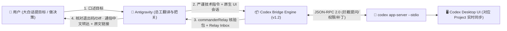

<div align="center">
  
  <h1>Antigravity Codex Bridge</h1>
  <p><strong>原生级 Google Antigravity ↔ OpenAI Codex 双引擎协同编排、强制总工转达闭环、UI 无感同步与可视化统计插件</strong></p>
  <p>
    <a href="./README_EN.md">English Documentation</a> ·
    <a href="#-核心优势解决什么痛点">核心优势</a> ·
    <a href="#-架构与总工转达闭环-commander-relay">工作原理</a> ·
    <a href="#-三层可视化与统计交互体验">可视化面板</a> ·
    <a href="#-一分钟安装指南">快速安装</a>
  </p>
  <p>
    
    
    
    
  </p>
</div>

---

## ✨ 项目简介

**Antigravity Codex Bridge (`codex-bridge`)** 是一个零第三方依赖（纯 Python 3.11+ 标准库实现）的 **Google Antigravity 原生插件**，将 **Antigravity** 打造成你的 **“总工程师 + 需求翻译官 + 强制验收转达中枢”**，把本机已安装的 **OpenAI Codex（Desktop 桌面端 / CLI）** 变成随时待命的 **“二号执行与独立审查引擎”**。

无论是 **全栈软件开发、独立交叉 Code Review、系统脚本与电脑自动化、学术论文与数据处理、还是 CAE/CFD 科学工程仿真**，你只需在 Antigravity 中用大白话描述意图，插件即可全自动完成：
**澄清与翻译需求 → 原生创建 Codex Desktop UI 可见会话 → 异步流式执行与中途追问拦截 → 生成结构化核验摘要（`commanderRelay`） → 由 Antigravity 二次把关并用通俗中文向你转达结论与下一步选项**。

---

## 🚀 核心优势（解决什么痛点？）

| 传统双工具割裂痛点 | Codex Bridge v1.2 原生解决方案 |
| :--- | :--- |
| **执行后没人兜底解读**：普通 CLI 跑完吐出一堆晦涩日志，或者 Codex 中途追问参数、权限受阻时无人接应 | **强制总工转达闭环（Commander Relay）**：拦截 `request_user_input` 中途提问与只读越权请求，自动归类 5 种状态（干净完成 / 命令报错 / 需澄清 / 权限受阻 / 异常失败）并写入 **Relay Inbox**，强制经由 Antigravity 核验翻译后再转达给你 |
| **输入门槛高**：复杂软件/工程任务给 Codex 写提示词时，不清楚该传哪些上下文与安全约束 | **总控翻译输入**：Antigravity 先阅读工作区并将自然语言转化为结构化 4 段式工程指令，再交由 Codex 执行 |
| **命令行新建会话在 UI 消失**：直接跑 `codex exec` 会被打上 `source="exec"` 标签，被 Codex 桌面端侧边栏默认过滤隐藏 | **零手动原生 UI 同步**：直接对接官方 `codex app-server --stdio` 协议（`clientInfo="Codex Desktop"`），原生创建 `source="vscode"` 对话、自动命名并归入目标 Project；同时支持历史 `exec` 会话一键转正 |
| **Windows 桌面版找不到 CLI**：安装 Microsoft Store 版 Codex Desktop 后系统 `PATH` 无 `codex` 命令，且升级目录名随时变动 | **全平台动态寻址**：自动从配置、MSIX 包目录、macOS App Bundle 或 `.sandbox-bin` 定位最新 `codex` 可执行文件 |
| **MCP 同步调用长任务必超时**：复杂重构、测试或仿真动辄运行数分钟至数十分钟，纯 MCP 工具极易卡死断连 | **快慢分离双通道架构**：毫秒级查询/收件箱/建会话/分支走 **13 个原生 MCP 工具**；长耗时执行走 **`codex-ctl` 异步流式引擎 + `codex-delegate` 独立子代理**，永不超时 |
| **配额黑盒 & 端口冲突**：不清楚周配额剩余多少；常见默认端口（如 `8765`）容易与本地服务冲突 | **实时配额监控 + 智能防冲突端口**：实时展示账户剩余配额百分比与重置倒计时；本地 Web 控制台默认采用 **`18765`** 端口并支持 `18765..18799` 自动顺延空闲端口 |

---

## 🧠 架构与总工转达闭环 (Commander Relay)



### 5 类自动识别的反馈转达分流（`commanderRelay.outcome`）
1. `completed_clean`：核对文件改动列表与命令退出码无误后，用通俗中文总结成果并附原文报告链接。
2. `completed_with_command_errors`：发现底层命令非零退出，若属小问题由 Antigravity 直接续聊指挥 Codex 修好；否则明确向你指出哪条校验失败。
3. `needs_clarification`：拦截到 Codex 中途调用 `request_user_input` 或句尾追问。若工作区已有答案，Antigravity 直接代答推进；若需你拍板，翻译为大白话选项交你决定。
4. `blocked_by_sandbox`：在 `read-only` 安全沙盒下自动拦截越权改写请求，向你说明 Codex 想执行的操作并征询是否放开 `workspace-write`。
5. `turn_failed`：自动诊断配额耗尽、网络或路径异常，给出切换模型或修复建议。

---

## 📊 三层可视化与统计交互体验

1. **Antigravity 对话内联卡片（Inline Generative UI Widget）**
   直接在聊天流内展示：**纳管项目总数、UI 可见会话数、账户实时剩余配额 % 与重置倒计时、模型 Token 占比条、近 14 个活跃日算力趋势**。
2. **Antigravity 侧边栏全屏控制台（4-Tab Standalone Artifact）**
   集 **数据与实时配额**、**项目库搜索**、**会话与分支（Fork）管理**、**交互式派单生成器** 于一体。
3. **独立本地实时 Web 控制台（默认 `http://127.0.0.1:18765`，空闲端口自动顺延）**
   运行 `codex-ctl serve-web` 打开实时管理后台：在线翻阅任意会话完整原始问答与底层命令输出、顶部实时提示 **待转达结果数**、一键点击 **「📨 交由 Antigravity 解读转达」**、一键 Fork 分支或导出 Markdown 报告。

---

## 🧰 功能清单

### 1. 13 个原生 MCP 工具（`codex-bridge`）
| MCP 工具名 | 用途说明 |
| :--- | :--- |
| `codex_bridge_relay_inbox` | **【v1.2 新增】** 检查待转达的任务完成结果、中途提问及 Codex 桌面端外部新动态，支持已读确认（`ack`） |
| `codex_bridge_digest_thread` | **【v1.2 新增】** 为任意会话生成结构化 `commanderRelay` 核验摘要（提问提取、报错命令、最新回复）供总工转达 |
| `codex_bridge_overview` | 全局项目、会话分类计数、待转达数、模型 Token 分布、每日活跃趋势与指派统计 |
| `codex_bridge_quota_and_models` | 实时查询 Codex 账户配额已用/剩余百分比、重置时间及当前可用模型目录 |
| `codex_bridge_doctor` | 8 项环境自检（Python、Codex 二进制、登录态、SQLite 库、`app-server` 握手延迟等） |
| `codex_bridge_list_projects` | 检索全部 Codex Desktop 项目（含根路径、会话数、累计 Token 与最近活跃时间） |
| `codex_bridge_list_threads` | 按项目、关键词或可见性（`ui` / `exec` / `subagent`）检索会话 |
| `codex_bridge_read_thread` | 读取任意会话的原始用户指令、推理摘要、执行的底层命令及原始回复 |
| `codex_bridge_export_report` | 将任意历史会话一键导出为结构清晰的独立 Markdown 报告 |
| `codex_bridge_create_thread` | 零手动操作，在目标项目下原生创建带自定义标题的 Codex Desktop UI 会话 |
| `codex_bridge_fork_thread` | 基于已有会话无损派生（Fork）独立新分支，安全对比不同修改方案 |
| `codex_bridge_promote_exec_threads` | 将旧版命令行 `source="exec"` 隐藏会话批量转正显示到 Codex Desktop UI |
| `codex_bridge_open_ui` | 直接拉起 Codex Desktop 桌面窗口并定位到目标项目工作区 |

### 2. 异步全能命令行控制器（`codex-ctl` / `scripts/codex_ctl.py`）
支持 `doctor`、`quota`、`inbox`、`digest`、`overview`、`projects`、`threads`、`read`、`export-report`、`create`、`fork`、`dispatch`（支持 `--output-schema` 与 `--ack-relay`）、`review`、`batch`、`promote`、`open-ui`、`export-ui`、`serve-web` 共 **18 个子命令**。

---

## ⚡ 一分钟安装与更新指南

**Windows (PowerShell)：**
```powershell
git clone https://github.com/Gurara-nya/antigravity-codex-bridge.git
cd antigravity-codex-bridge
.\install.ps1
```

**macOS / Linux：**
```bash
git clone https://github.com/Gurara-nya/antigravity-codex-bridge.git
cd antigravity-codex-bridge
chmod +x install.sh && ./install.sh
```

> 若之前已克隆过仓库，执行 `git pull && .\install.ps1`（或 `./install.sh`）即可无损升级到最新版。

---

## 🧪 测试与打包发布

```bash
python tests/test_codex_bridge.py
python scripts/build_release.py
```

## 📄 开源协议

本项目基于 [MIT License](./LICENSE) 开源。
