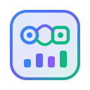

<div align="center">
  
  <h1>Antigravity Codex Bridge</h1>
  <p><strong>Native Dual-Agent Orchestration, Mandatory Commander Feedback Relay, Zero-Click UI Sync & Visual Analytics Plugin for Google Antigravity ↔ OpenAI Codex</strong></p>
  <p>
    <a href="./README.md">中文文档</a> ·
    <a href="#-why-codex-bridge-v12">Why Codex Bridge</a> ·
    <a href="#-three-visual-surfaces">Visual Dashboards</a> ·
    <a href="#-quick-install--upgrade">Quick Install</a>
  </p>
</div>

---

## ✨ Overview

**Antigravity Codex Bridge (`codex-bridge` v1.2)** is a zero-dependency (Python 3.11+ stdlib only) native plugin for **Google Antigravity**. It turns Antigravity into your **Lead Architect, Prompt Translator, and Mandatory Feedback Relay** while orchestrating **OpenAI Codex (Desktop & CLI)** across **Windows, macOS, and Linux**.

---

## 🚀 Why Codex Bridge v1.2?

- **Mandatory Commander Relay Loop (`commanderRelay` + Relay Inbox)**: Every Codex completion, mid-turn `request_user_input` question, non-zero command exit, or sandbox escalation is captured into a structured `commanderRelay` verification digest (`completed_clean`, `completed_with_command_errors`, `needs_clarification`, `blocked_by_sandbox`, `turn_failed`) and tracked in the Relay Inbox (`codex_bridge_relay_inbox`)—ensuring Antigravity always verifies, answers trivial technical follow-ups, and translates outcomes into plain language for you.
- **Zero-Click Native Codex Desktop UI Sync**: Creates native `source="vscode"` (`originator="Codex Desktop"`) threads via `codex app-server --stdio`, names them clearly, and assigns them directly to your Codex Projects—plus 1-click promotion for legacy `exec` threads.
- **13 Fast Native MCP Tools + Async `codex-ctl` Engine**: Sub-second analytics, live account rate-limit quota & model catalog checks, Relay Inbox & thread verification digests, session branching (`thread/fork`), adversarial Git Code Review (`review`), and parallel batch execution (`batch`).
- **Conflict-Free Visual Dashboards**: Inline Generative UI Widget, 4-tab Full-Screen Side-Pane Artifact, and a standalone **Live Local Web Console** on port **`18765`** (`http://127.0.0.1:18765`, with automatic `18765..18799` free-port fallback).

---

## ⚡ Quick Install & Upgrade

**Windows (PowerShell):**
```powershell
git clone https://github.com/Gurara-nya/antigravity-codex-bridge.git
cd antigravity-codex-bridge
.\install.ps1
```

**macOS / Linux:**
```bash
git clone https://github.com/Gurara-nya/antigravity-codex-bridge.git
cd antigravity-codex-bridge
chmod +x install.sh && ./install.sh
```

---

## 🧪 Testing & Release Packaging

```bash
python tests/test_codex_bridge.py
python scripts/build_release.py
```

## 📄 License

Released under the [MIT License](./LICENSE).
